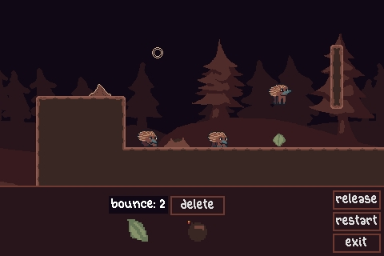

Submission to the Cozy Fall Jam 2026.

Guide echidnas to an anthill by planting roots to guide them.

How to play:

- Plant your roots by selecting them in the hotbar and clicking them down in the game world to boost the echidnas to the ant hill
- Press space or the release button to deploy the them. They can be reset by pressing again
- To remove items throw the bomb at them
- Hold down right click and move the mouse to pan the screen

play it on [itch](https://lochi-makes-games.itch.io/ants)

Credits:

- pirkkala font by Otto Ojala (ottoojala.com)
